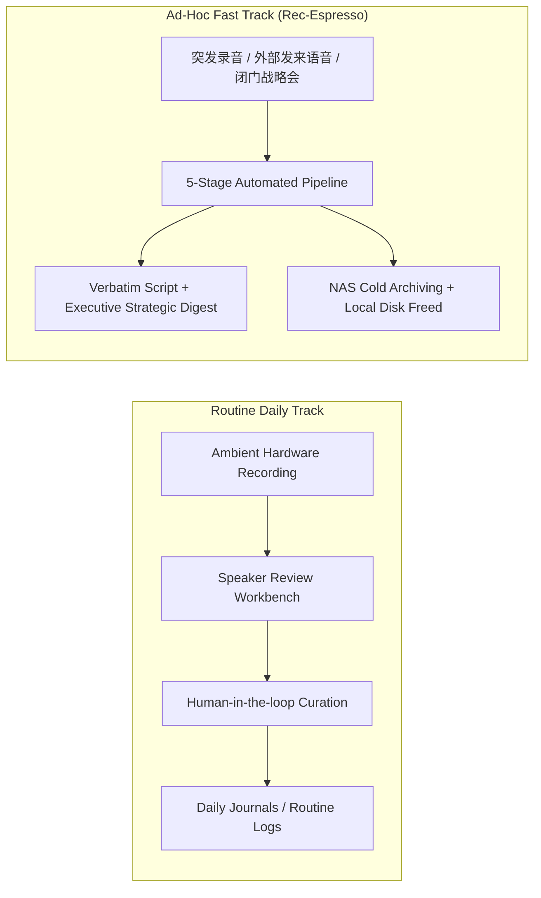
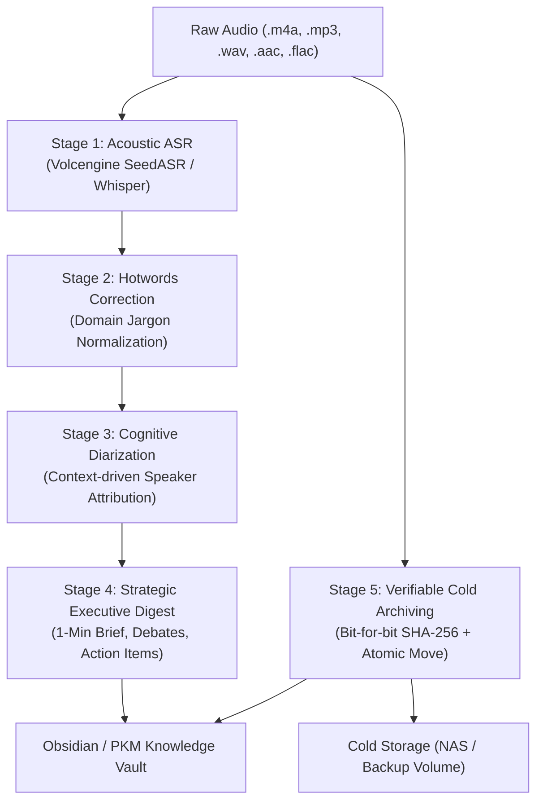

# ☕ PlotLoop Rec-Espresso

[](https://opensource.org/licenses/MIT)
[](https://www.python.org/)
[](https://github.com/granken/plotloop)

> **Lightning audio extraction, cognitive diarization, strategic executive synthesis, and verifiable cold-storage archiving.**  
> 极速端到端会议录音萃取流水线：高保真声学转写、专有热词纠错、认知声纹角色映射、高维战略研报提炼与可验证冷存储归档。

---

## 🌟 Why PlotLoop Rec-Espresso?

In enterprise knowledge work and executive workflows, meeting audio processing generally bifurcates into two distinct operating modes:



- **Routine Track (`plotloop-speaker-review`)**: Designed for daily scheduled meetings and background ambient capture, where human verification and daily journal collation happen incrementally.
- **Fast Track (`plotloop-rec-espresso`)**: Designed for high-stakes, ad-hoc, or emergency voice recordings (e.g. an impromptu offline strategy session or urgent audio memo). It operates as an **autonomous, end-to-end pipeline** delivering an authoritative strategic summary within minutes, while automatically moving multi-gigabyte audio to verifiable cold storage.

---

## 🏗️ Architecture & Pipeline



### Key Pillars

1. **Dual ASR Engines**: Native support for **Volcengine SeedASR** (AUC acoustic diarization with millisecond timestamps) and **OpenAI Whisper** (`turbo` / `large-v3`).
2. **Domain Jargon Normalization**: Built-in hotwords engine with length-descending multi-pass replacement to eliminate phonetic transcription errors.
3. **Cognitive Diarization**: Goes beyond naive acoustic clustering (`Speaker 1`, `Speaker 2`) by using LLM context cues (agenda lead, tone, cross-functional questions, roster context) to attribute authentic identities.
4. **Strategic Executive Synthesis**: Generates high-density decision briefs featuring YAML frontmatter, 1-minute brief, debate tensions, Mermaid diagrams, and action item ledgers.
5. **Verifiable Cold Storage Archiving**:
   - Copies audio to target storage with temporary `.part` buffers.
   - Performs two-way bit-for-bit **SHA-256 checksum verification**.
   - Atomic promotion upon checksum match.
   - Leaves a lightweight local `.md` pointer card in place of the deleted audio.
   - Automatically maintains an audit ledger to track historical archives.

---

## 🚀 Quick Start

### Installation

```bash
# Clone the repository
git clone https://github.com/granken/plotloop-rec-espresso.git
cd plotloop-rec-espresso

# Install in editable mode
pip install -e .
```

### Configuration

Copy the example configuration:
```bash
cp config.example.json config.json
```
Customize `config.json` with your ASR provider, storage target paths, and domain glossaries.

---

## 💻 CLI Usage

### 1. Process an Audio Recording
Run the end-to-end pipeline:
```bash
plotloop-espresso run /path/to/meeting.m4a --output-dir ./transcripts --archive
```

### 2. Standalone Verifiable Cold Archiver
Move multi-gigabyte audio files to NAS or cold storage, verify SHA-256, leave local `.md` pointer cards, and reclaim disk space:
```bash
plotloop-espresso archive /path/to/audios/ \
  --target-dir /Volumes/homedrive/audio_backup \
  --ledger ./_index/audio_archive_ledger.md
```

### 3. Apply Domain Hotwords Correction
Correct transcription errors in existing Markdown files:
```bash
plotloop-espresso hotwords --glossary ./glossary.json ./transcripts/*.md
```

### 4. Dry Run Mode
Preview discovered audio files and operations without executing:
```bash
plotloop-espresso run /path/to/folder/ --dry-run
```

---

## 🤖 Agent Skill Integration

`plotloop-rec-espresso` is packaged as a standard Agent Skill, compatible with **Claude Code**, **Gemini Antigravity**, **OpenAI Codex**, and **OpenClaw**.

### Installing the Skill

Link or copy the skill definition into your agent's config folder:

```bash
# For Gemini / Antigravity
ln -s "$(pwd)/skills/plotloop-rec-espresso" ~/.gemini/config/skills/

# For Claude Code
ln -s "$(pwd)/skills/plotloop-rec-espresso" ~/.claude/skills/

# For OpenAI Codex
ln -s "$(pwd)/skills/plotloop-rec-espresso" ~/.codex/skills/
```

When prompted, the agent automatically orchestrates:
- Executing the local ASR transcription CLI.
- Applying prompt templates from `references/prompt_templates.md` for cognitive speaker attribution.
- Synthesizing the final executive digest into your Obsidian or Markdown vault.
- Verifying cold-storage archiving and pointer cards.

---

## 📂 Repository Layout

```text
plotloop-rec-espresso/
├── LICENSE                        # MIT License
├── README.md                      # Documentation & Overview
├── pyproject.toml                 # Modern Python build spec & CLI endpoints
├── config.example.json            # Template configuration
├── espresso/                      # Core Python package
│   ├── __init__.py                # Package entry & exports
│   ├── cli.py                     # CLI entrypoint (plotloop-espresso / espresso)
│   ├── asr.py                     # ASR adapters (Volcengine SeedASR, Whisper, Mock)
│   ├── hotwords.py                # Jargon & glossary replacement engine
│   ├── diarization.py             # Cognitive speaker attribution & turn parser
│   ├── summarizer.py              # Strategic executive synthesis & action ledger
│   ├── archiver.py                # Verifiable cold-storage archiver & pointer cards
│   └── pipeline.py                # 5-stage pipeline orchestrator
├── skills/
│   └── plotloop-rec-espresso/     # Universal AI Agent Skill
│       ├── SKILL.md               # Agent skill definition & execution SOP
│       └── references/
│           └── prompt_templates.md# Cognitive diarization & executive digest prompts
└── examples/
    ├── demo-transcript.md         # Anonymized sample verbatim transcript
    └── demo-summary.md            # Anonymized sample executive summary
```

---

## 🤝 Part of the PlotLoop Family

- [`plotloop`](https://github.com/granken/plotloop): Autonomous agent loops for continuous knowledge extraction.
- [`plotloop-hub`](https://github.com/granken/plotloop-hub): Live agent loops dashboard and coordination hub.
- [`plotloop-speaker-review`](https://github.com/granken/plotloop-speaker-review): Local-first workbench for reviewing speaker labels in routine transcripts.
- [`plotloop-rec-espresso`](https://github.com/granken/plotloop-rec-espresso): Lightning audio extraction, cognitive diarization, and verifiable archiving.

---

## 📄 License

Released under the [MIT License](LICENSE). Copyright (c) 2026 granken.
