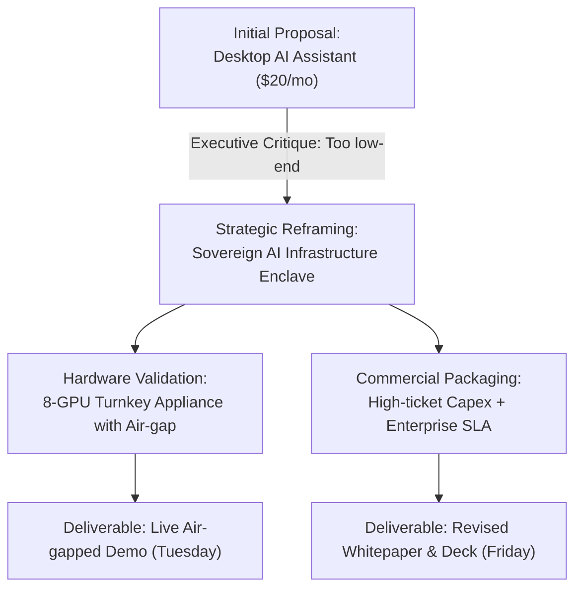

# Executive Summary: Turnkey AI Appliance Architecture & Go-to-Market

## 1. Executive Takeaway (1-Minute Brief)
- **Strategic Course Correction**: Explicitly rejected positioning the AI appliance as an "individual productivity assistant". Reframed it as a **Sovereign AI Enclave Appliance** tailored for regulated enterprises, public sector, and defense.
- **Hardware & Architecture**: Validated 8x GPU turnkey node with encrypted NVMe storage, air-gapped local agent orchestrator, and zero external telemetry.
- **Commercial Model**: Pivoted from low-margin SaaS seat subscriptions to high-ticket infrastructure capex + annual maintenance licensing.

## 2. Strategic Alignment Flow

## 3. Key Strategic Debates & Resolutions

### Positioning Tension: Desktop Tool vs. Sovereign Infrastructure
- **Challenge**: The product team initially emphasized ease-of-use and knowledge worker workflows, which diluted enterprise credibility and compressed pricing power.
- **Resolution**: Reframed around customer sovereignty and data security guarantees. The hardware chassis is positioned as an impenetrable compute vault for proprietary organizational intelligence.

### Commercial Strategy: SaaS Seats vs. Appliance Capex
- **Challenge**: SaaS pricing models force comparison against commodity cloud consumer tools and trigger bureaucratic monthly budget friction.
- **Resolution**: Package as turnkey hardware-software integrated appliance, qualifying for enterprise infrastructure capital expenditure with higher contract values.

## 4. Action Items Ledger

| # | Action Item | Owner | Collaborators | Due Date | Deliverable |
| :- | :--- | :--- | :--- | :--- | :--- |
| 1 | Rewrite positioning deck to "Sovereign AI Enclave" | Sarah Lin | David Kim | 2026-10-24 | Updated Keynote & One-pager |
| 2 | Stage air-gapped live demo with disconnected WAN | Marcus Chen | Tech Team | 2026-10-28 | Offline benchmark validation |
| 3 | Model pricing scenarios for 8x L40S and 8x H100 tiers | David Kim | Finance | 2026-10-29 | Enterprise pricing matrix |
