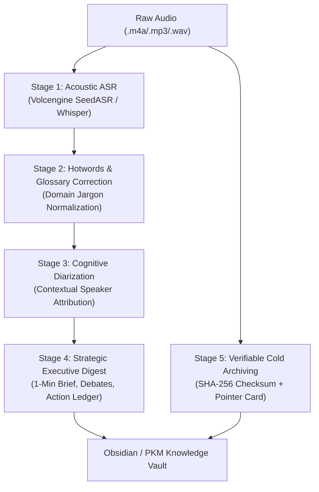

# PlotLoop Rec-Espresso · Agent Skill Specification

## 1. Overview & Dual-Track Philosophy

In modern knowledge workflows, meeting audio processing splits into two distinct tracks:

| Dimension | Routine Track (`plotloop-speaker-review`) | Ad-Hoc Fast Track (`plotloop-rec-espresso`) |
| :--- | :--- | :--- |
| **Trigger** | Scheduled daily syncs, hardware ambient recordings | Ad-hoc offline meetings, high-stakes executive briefings, sudden voice memos |
| **Pipeline Mode** | Human-in-the-loop: manual speaker curation -> daily notes | **Fully automated end-to-end pipeline (Pipeline-as-a-Service)** |
| **Throughput** | Batched once per day | On-demand instant processing |
| **Deliverables** | Daily journal log entries | Standalone verbatim transcript + Strategic executive decision report + Audio archive card |
| **Storage Lifecycle** | Retained locally during active curation | Verifiable cold-storage archiving (NAS / External Drive) to reclaim local disk space |

---

## 2. The 5-Stage Espresso Pipeline



1. **Stage 1: Acoustic Speech Recognition**
   Converts multi-speaker audio into timestamped text chunks with acoustic clustering tags (`[HH:MM:SS - HH:MM:SS] Speaker 1: ...`).
2. **Stage 2: Hotwords & Domain Terminology Correction**
   Replaces phonetic errors and domain-specific acronyms using customized glossary dictionaries.
3. **Stage 3: Cognitive Speaker Diarization**
   Bridges raw acoustic tags to authentic identities by analyzing conversation dynamics, conversational roles, and roster context.
4. **Stage 4: Strategic Executive Synthesis**
   Generates a high-density executive briefing document featuring frontmatter, 1-minute brief, debate tensions, and action item tracking.
5. **Stage 5: Verifiable Cold-Storage Archiving**
   Copies raw media to cold storage, verifies bit-for-bit SHA-256 hashes, replaces the local audio file with a lightweight `.md` pointer card, and logs the operation in an audit ledger.

---

## 3. Agent Execution Guidelines

When the user asks to process an ad-hoc recording or meeting audio:

### Step 1: Execute Pipeline CLI
Run the local orchestrator:
```bash
espresso run /path/to/meeting.m4a --output-dir ./transcripts --archive
```
Or with custom configuration:
```bash
espresso run /path/to/meeting.m4a --config ./config.json --archive
```

### Step 2: Cognitive Speaker Attribution
Read the raw acoustic transcript and prompt template from `references/prompt_templates.md`. Match speakers based on conversational cues:
- Who initiates the meeting?
- Who challenges proposals or provides executive oversight?
- Who provides architectural or technical feasibility explanations?

### Step 3: Deliverables Output
Produce two Markdown files in the target directory:
1. `YYYYMMDD_<Title>_transcript.md`: Verbatim script with confirmed speaker names and millisecond timestamps.
2. `YYYYMMDD_<Title>_summary.md`: Strategic executive briefing report with frontmatter and action item ledger.

### Step 4: Storage Verification
Confirm that:
- Audio has been archived to cold storage.
- Local audio file was pruned (if configured), leaving `<filename>.md` as a pointer card.
- Audit ledger has recorded timestamp and SHA-256 checksum.
